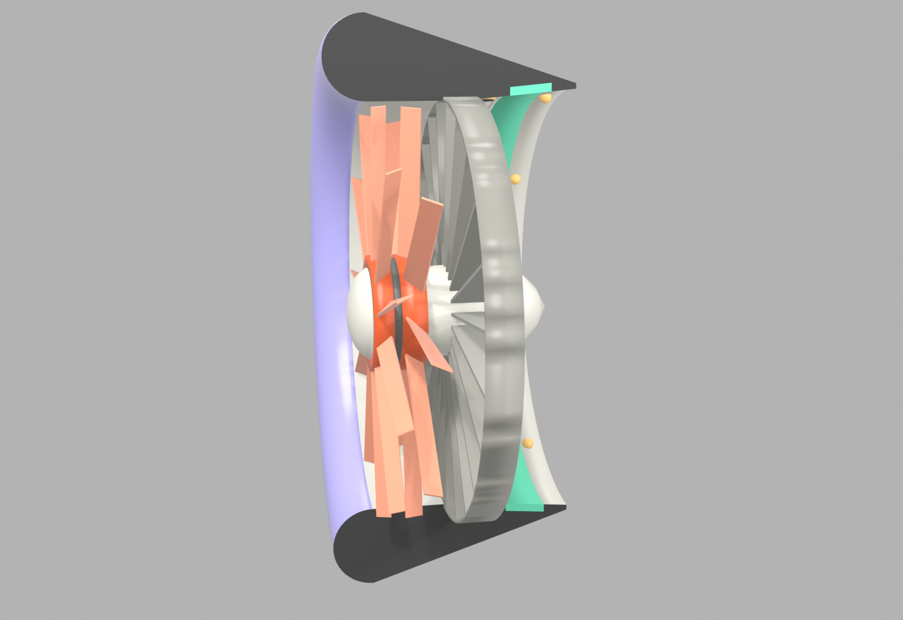

# Quiet Ducted Fan

**Making compact ducted fans quiet enough for cities — without losing efficiency.**



*Exploded view: contra-rotating rotors, then the parts separate.*

https://github.com/user-attachments/assets/b687fe89-71f3-4fa7-bc0d-1da044c63838


## The problem

Personal flying vehicles and drones are loud. Open-rotor designs are criticised for a tonal, lawnmower-like sound, and jet-powered flyers are louder still. Large, slow rotors are quiet but bulky; small, compact fans are normally loud. Noise is one of the main barriers to flying machines in cities.

## The approach

A contra-rotating ducted fan designed for low noise from the start:

- **Low tip speed (120 m/s)** — the biggest single noise lever
- **Blade and stator counts chosen to trap tones** — 11 / 9 contra-rotating rotors with 23 stators, so the main rotor–stator interaction tones cannot escape the duct (Tyler–Sofrin mode cut-off)
- **Active noise cancellation in the duct** — a ring of small speakers driven from an rpm sensor cancels the remaining tones
- **Acoustic liner and a smooth lip** for the broadband noise that is left
- **No exposed blades** — fully ducted for safety near obstacles

## Current results (simulation — not yet measured)

| Item | Value |
|---|---|
| Full-scale duct (4-duct vehicle) | ~830 mm, ~49 N/kW hover estimate |
| Bench model | 150 mm, two rotors |
| Simulated ANC tone reduction | ~20 dBA (single error mic, best case) |
| Simulated overall reduction | ~7.5 dBA (broadband not cancellable) |

These are first-principles estimates and will be replaced by bench-rig measurements.

## Repository

```
scripts/ducted_fan_layout.py   sizing, 1:10 geometry, acoustic mode check, SolidWorks globals export
scripts/anc_fan_sim.py         ANC simulation: tones, FxLMS cancellation, speaker-ring sizing, audio output
cad/sw_globals_1to10.txt       SolidWorks global variables (Tools > Equations > Link to external file)
renders/                       cutaway renders and exploded-view animation (fan_explode.mp4)
results/                       bench-rig data (coming)
```

## Running the scripts

```bash
pip install -r requirements.txt
python scripts/ducted_fan_layout.py
python scripts/anc_fan_sim.py                     # full-scale duct
python scripts/anc_fan_sim.py --preset rig        # 150 mm bench rig
python scripts/anc_fan_sim.py --b1 11 --b2 9 --stators 23
```

## Roadmap

- [x] Sizing, layout and scaling analysis
- [x] Acoustic mode analysis and blade/stator selection
- [x] ANC simulation with before/after audio
- [x] Cutaway CAD/render and exploded-view animation
- [ ] SolidWorks CFD: lip suction in hover, duct drag in crossflow
- [ ] Static printed cutaway model
- [ ] 150 mm two-rotor bench rig: thrust, power and noise measurements
- [ ] Physical ANC test
